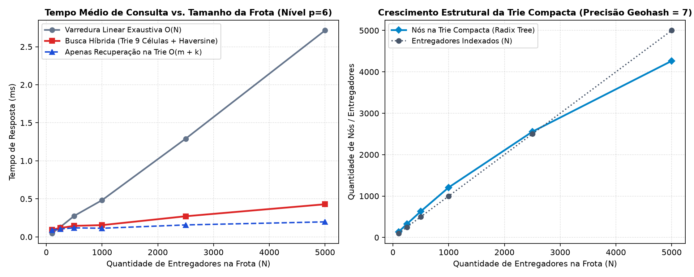
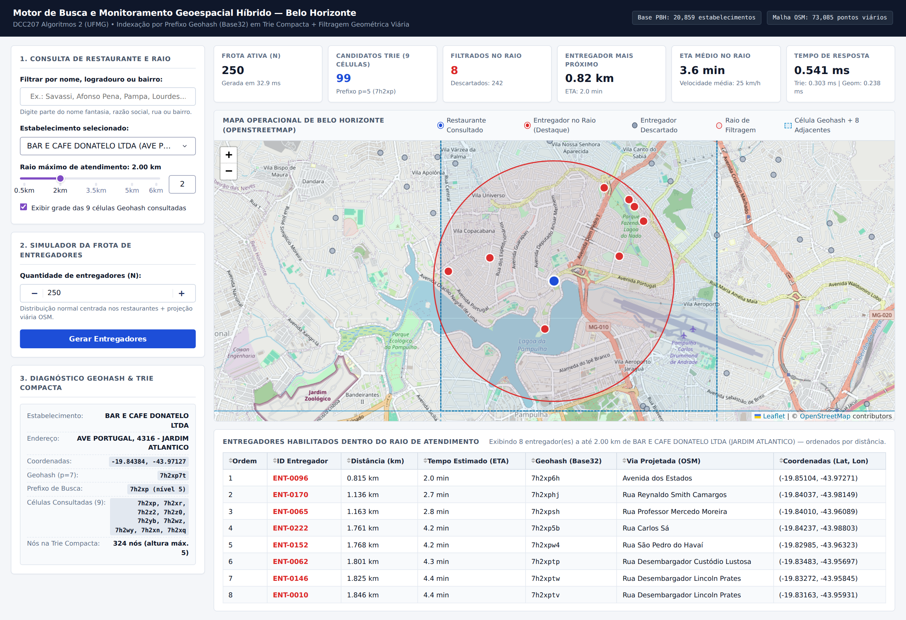
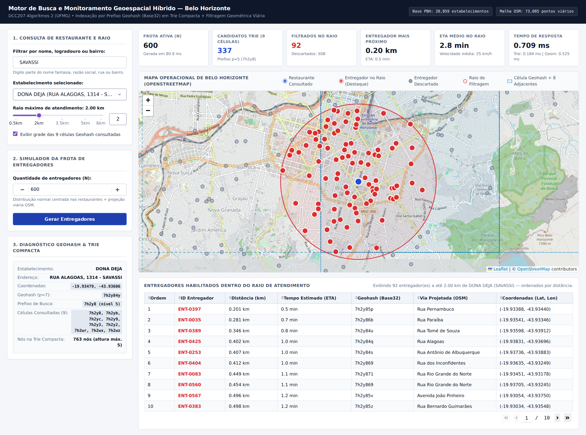
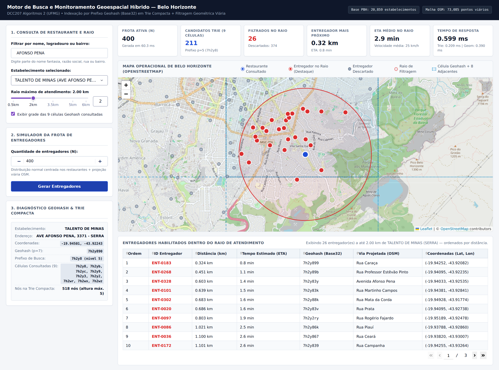

# Trabalho Prático 1 — Indexação Geoespacial e Geometria Computacional Híbrida

**Universidade Federal de Minas Gerais (UFMG)**  
**Instituto de Ciências Exatas — Departamento de Ciência da Computação**  
**Disciplina:** DCC207 — Algoritmos 2 (Prof. Renato Vimieiro)
---

**Aluno:** Luiz Felipe Lima Costa

## 1. Visão Geral e Problema Abordado

Este projeto implementa um motor de busca e monitoramento geoespacial híbrido para visualização e consulta de uma frota de entregadores em operação na cidade de Belo Horizonte. A ferramenta integra estruturas de dados de indexação por prefixo sobre strings (`Geohash` + `Árvore Trie Compacta`) com algoritmos de geometria computacional esférica e restrição viária real extraída do OpenStreetMap (`osmnx`).

O sistema processa a base oficial de bares e restaurantes de Belo Horizonte (`bares.csv.gz`, contendo **20.859 estabelecimentos** distribuídos em **451 bairros**) e a malha viária transitável da cidade (**73.085 pontos viários** extraídos de **32.247 vértices** e **82.877 segmentos** do grafo dirigido do OpenStreetMap). Na interface web interativa (`Dash` + `dash-leaflet`), o usuário pode:

1. Buscar estabelecimentos por nome fantasia, razão social, logradouro ou bairro.
2. Ajustar dinamicamente o raio máximo de atendimento (em quilômetros).
3. Simular e regenerar a frota com $N$ entregadores posicionados segundo uma distribuição normal bidimensional centrada equitativamente nos restaurantes e projetados (*snapped*) exclusivamente sobre vias transitáveis reais da cidade.
4. Inspecionar no mapa interativo as 9 células Geohash consultadas (célula central + 8 adjacentes), o círculo do raio de filtragem, os entregadores habilitados em destaque (pinos vermelhos) e os entregadores descartados fora do raio (pinos cinzas), acompanhados de tabela descritiva ordenada por distância e tempo estimado de chegada (ETA).

---

## 2. Arquitetura do Sistema e Decisões de Projeto

A arquitetura foi estruturada em módulos independentes dentro do diretório `src/`, separando rigorosamente as estruturas de dados autorais da camada de apresentação:

```text
.
├── app.py                        # Aplicação web interativa (Dash + dash-leaflet)
├── assets/
│   └── style.css                 # Folha de estilos da interface geoespacial
├── bares.csv.gz                  # Base de dados bruta de estabelecimentos de BH (PBH)
├── data/
│   ├── bh_road_network.pkl       # Cache local dos 73.085 pontos viários do OSM de BH
│   └── bh_restaurants_geocoded.pkl # Estabelecimentos geocodificados sobre a malha viária
├── docs/
│   ├── benchmark_results.json    # Métricas brutas extraídas dos experimentos reais
│   └── images/                   # Gráficos e capturas de tela reais da interface
├── Dockerfile                    # Configuração para execução reprodutível em contêiner
├── pytest.ini                    # Configuração da suíte de testes automatizados
├── requirements.txt              # Dependências do ambiente Python
├── scripts/
│   ├── capture_screenshots.py    # Automação de captura de telas da interface real
│   └── run_experiments.py        # Script de avaliação experimental e geração de gráficos
├── src/
│   ├── data_loader.py            # Extração da malha OSM (osmnx) e geocodificação viária
│   ├── geohash.py                # Codificação/decodificação Base32 e vizinhança Geohash
│   ├── geometry.py               # Distância ortodrômica de Haversine e cálculo de ETA
│   ├── models.py                 # Estruturas de dados imutáveis de domínio
│   ├── simulator.py              # Gerador sintético gaussiano com projeção viária (snapping)
│   ├── spatial_engine.py         # Motor de busca híbrida (Trie Compacta + Haversine)
│   └── trie.py                   # Implementação autoral da Árvore Trie Compacta (Radix Tree)
└── tests/
    ├── test_geohash.py           # Testes de intercalação binária, bbox e problema de borda
    ├── test_integration_app.py   # Testes de integração com a base real e callbacks Dash
    ├── test_simulator.py         # Testes de distribuição equitativa e snapping viário
    └── test_trie_and_engine.py   # Testes de invariantes da Trie Compacta e exatidão da busca
```

### 2.1. Codificação Geohash e Vizinhança (`src/geohash.py`)

Cada coordenada geográfica $(\text{latitude}, \text{longitude})$ é convertida para uma string em `Base32` (`0123456789bcdefghjkmnpqrstuvwxyz`) de precisão $p = 7$ (35 bits no total, correspondendo a células de aproximadamente $153\,\text{m} \times 153\,\text{m}$ na latitude de Belo Horizonte):

- **Intercalação binária (`encode`)**: O intervalo de longitude $[-180^\circ, 180^\circ]$ ocupa os bits de índice par $(0, 2, 4, \dots)$ e o intervalo de latitude $[-90^\circ, 90^\circ]$ ocupa os bits de índice ímpar $(1, 3, 5, \dots)$. A cada iteração, o intervalo correspondente é bissectado na metade; se a coordenada for maior ou igual ao ponto médio, registra-se o bit `1` e atualiza-se o limite inferior; caso contrário, registra-se `0` e atualiza-se o limite superior. A cada 5 bits acumulados, emite-se o caractere Base32 correspondente.
- **Resolução do Problema de Borda (`neighbors` e `covering_prefixes_for_radius`)**: Pontos geograficamente muito próximos podem cair em células com prefixos distintos quando separados por uma fronteira de subdivisão (por exemplo, `7h2xp` e `7h2xr`). Para eliminar falsos negativos antes da filtragem geométrica:
  1. Dado o raio de atendimento $R$ escolhido pelo usuário, seleciona-se dinamicamente o maior nível de prefixo $m \le 7$ tal que a menor dimensão linear da célula Geohash de comprimento $m$ seja $\ge R$.
  2. Determina-se o prefixo central do restaurante de tamanho $m$ e calculam-se as **8 células adjacentes** (`N`, `NE`, `E`, `SE`, `S`, `SW`, `W`, `NW`) deslocando o centro da caixa delimitadora decodificada (`decode_bbox`) em $\pm \Delta \text{lat}$ e $\pm \Delta \text{lon}$.
  3. Dessa forma, a união das 9 células garante matematicamente a cobertura integral de qualquer círculo de raio $R$ centrado em qualquer ponto interno à célula central.

### 2.2. Estrutura de Nós e Invariantes da Trie Compacta (`src/trie.py`)

A indexação da frota foi implementada integralmente do zero através da classe `CompactTrie` (uma Árvore Patricia / Radix Tree), sem uso de bibliotecas prontas:

- **Estrutura do Nó (`RadixTrieNode`)**:
  - `label: str`: armazena a substring completa que rotula a aresta de entrada do nó (vazia apenas na raiz).
  - `children: Dict[str, RadixTrieNode]`: tabela de dispersão indexada pelo **primeiro caractere** do `label` de cada filho. Como o alfabeto Base32 tem tamanho constante ($|\Sigma| = 32$) e todas as arestas que partem de um mesmo nó possuem primeiro caractere distinto, a transição em cada nível ocorre em tempo $O(1)$.
  - `values: List[T]`: lista de entregadores cujas chaves Geohash terminam exatamente neste nó.
- **Invariante de Compactação**: Todo nó interno que não armazena valores (`len(values) == 0`) possui grau de ramificação $\ge 2$. Caminhos unários são fundidos em uma única aresta. Durante a inserção (`insert`), caso uma nova chave compartilhe apenas um prefixo parcial com o `label` de um filho existente, a aresta é dividida (*split*) criando um nó intermediário com o prefixo comum e ramificando os sufixos divergentes.
- **Busca por Prefixo em Tempo $O(m + k)$ (`search_prefix`)**:
  1. **Localização do *locus* em $O(m)$**: Percorre a árvore a partir da raiz comparando os caracteres do prefixo de consulta (comprimento $m$) com os rótulos das arestas. Se o prefixo terminar no meio ou no final do rótulo de uma aresta, esse nó é o *locus* da subárvore.
  2. **Coleta da subárvore em $O(k)$**: Como todo nó interno sem valores possui pelo menos 2 filhos, o número total de nós internos na subárvore é estritamente limitado pelo número de folhas/nós com valores. Assim, a travessia em profundidade sobre a subárvore do *locus* visita número de nós proporcional aos $k$ entregadores armazenados sob aquele prefixo, garantindo complexidade de tempo $O(m + k)$.

### 2.3. Filtragem Geométrica Híbrida (`src/geometry.py` e `src/spatial_engine.py`)

Após recuperar os $k$ candidatos contidos nas 9 células Geohash em tempo $O(m + k)$, o motor `SpatialSearchEngine` calcula a distância ortodrômica exata entre o restaurante $(\phi_1, \lambda_1)$ e cada entregador candidato $(\phi_2, \lambda_2)$ pela fórmula de Haversine ($R_{\text{Terra}} = 6371{,}0088\,\text{km}$):

$$d = 2 R_{\text{Terra}} \arctan2\left(\sqrt{a}, \sqrt{1 - a}\right), \quad a = \sin^2\left(\frac{\Delta \phi}{2}\right) + \cos(\phi_1)\cos(\phi_2)\sin^2\left(\frac{\Delta \lambda}{2}\right)$$

- Entregadores com $d \le \text{raio}$ são classificados como **habilitados** (`matched_couriers`), ordenados por distância crescente e destacados no mapa com **pino vermelho**.
- Entregadores com $d > \text{raio}$ são classificados como **descartados** (`discarded_couriers`) e exibidos no mapa sem destaque com **pino cinza**.
- O tempo estimado de chegada (ETA, em minutos) é computado assumindo velocidade média operacional urbana de $25\,\text{km/h}$ ($\text{ETA} = \frac{d}{25} \times 60$).

### 2.4. Simulador de Frota e Restrição Viária (`src/simulator.py` e `src/data_loader.py`)

O gerador sintético (`FleetSimulator.generate_couriers`) atende às duas restrições fundamentais do enunciado:

1. **Distribuição Espacial Baseada em Demanda**: Quando o usuário informa $N$ e aciona o botão `"Gerar Entregadores"`, a Trie anterior é descartada (`trie.clear()`) e $N$ novas posições são geradas do zero. Os $N$ entregadores são alocados equitativamente entre os centros disponíveis (restaurantes) por permutação uniforme sem viés. Para cada entregador, sorteiam-se deslocamentos métricos $(\Delta y, \Delta x) \sim \mathcal{N}(0, \sigma^2)$ com $\sigma = 380\,\text{m}$ centrados na coordenada do restaurante âncora, produzindo alta densidade no entorno imediato dos polos gastronômicos e decaimento gaussiano gradual com a distância.
2. **Restrição Viária (Realismo Geográfico via OpenStreetMap)**: A coordenada matemática bruta $(\text{lat}_{\text{raw}}, \text{lon}_{\text{raw}})$ jamais é usada diretamente no mapa. O índice `RoadNetworkIndex` projeta (*snaps*) cada ponto para o ponto viário transitável mais próximo extraído do grafo `drive` de Belo Horizonte via `osmnx`, indexado em uma grade de hash espacial (*spatial hash grid*) com células de $0{,}0025^\circ$. Isso garante que nenhum entregador apareça sobre a Lagoa da Pampulha, parques fechados ou no interior de edificações.

Além disso, como o arquivo bruto `bares.csv.gz` fornece os endereços administrativos da Prefeitura de Belo Horizonte (`DESC_LOGRADOURO`, `NOME_LOGRADOURO`, `NUMERO_IMOVEL`, `NOME_BAIRRO`) sem colunas explícitas de latitude/longitude, o módulo `src/data_loader.py` geocodifica os 20.859 estabelecimentos cruzando os nomes normalizados dos logradouros e números prediais diretamente contra os segmentos de rua do grafo viário do OpenStreetMap de Belo Horizonte, garantindo correspondência geográfica fiel por rua e bairro.

---

## 3. Avaliação Experimental e Tempos de Resposta (Runtime)

Todos os experimentos abaixo foram executados sobre os dados reais de Belo Horizonte através do script reproduzível `scripts/run_experiments.py` (resultados completos salvos em `docs/benchmark_results.json`).

### 3.1. Escalabilidade: Busca Híbrida na Trie vs. Varredura Linear Exaustiva

A Tabela 1 apresenta o comportamento estrutural da Trie Compacta e os tempos médios de execução variando o tamanho da frota $N$ de $100$ a $5.000$ entregadores (média de 50 consultas distribuídas por Belo Horizonte em nível de prefixo $p = 6$):

| Frota ($N$) | Geração + Snap OSM (ms) | Construção da Trie (ms) | Nós na Trie Compacta | Altura Máx. da Trie | Candidatos na Trie ($k$) | Apenas Trie $O(m+k)$ (ms) | Busca Híbrida Total (ms) | Varredura Linear $O(N)$ (ms) | Speedup Híbrido vs. Linear |
| ---: | ---: | ---: | ---: | ---: | ---: | ---: | ---: | ---: | ---: |
| 100 | 15,85 | 0,23 | 134 | 5 | 2,7 | 0,0889 | 0,0946 | 0,0469 | 0,50x |
| 250 | 34,47 | 0,60 | 324 | 5 | 6,0 | 0,1040 | 0,1165 | 0,1291 | 1,11x |
| 500 | 65,54 | 0,98 | 631 | 5 | 13,1 | 0,1186 | 0,1452 | 0,2759 | 1,90x |
| 1.000 | 127,00 | 1,88 | 1.209 | 5 | 26,8 | 0,1135 | 0,1546 | 0,4828 | 3,12x |
| 2.500 | 309,66 | 5,08 | 2.554 | 5 | 71,2 | 0,1571 | 0,2712 | 1,2910 | 4,76x |
| 5.000 | 621,29 | 10,15 | 4.264 | 5 | 140,6 | 0,1974 | 0,4290 | 2,7138 | **6,33x** |



**Análise dos Resultados:**
1. **Eficiência da Poda por Prefixo**: Para $N = 5.000$ entregadores, a busca nas 9 células da Trie Compacta reduz o espaço de avaliação geométrica de $5.000$ para uma média de apenas $140{,}6$ candidatos ($2{,}8\%$ da frota total), alcançando um **ganho de velocidade de 6,33 vezes** sobre a varredura linear exaustiva ($0{,}429\,\text{ms}$ contra $2{,}714\,\text{ms}$).
2. **Compressão de Caminhos na Trie Compacta**: Como todos os entregadores estão em Belo Horizonte (compartilhando prefixos Geohash como `7h2x` e `7h2y`), a Trie Compacta mantém altura máxima igual a **5 níveis** mesmo para chaves de 7 caracteres, e armazena $5.000$ entregadores em $4.264$ nós (enquanto uma Trie não compacta exigiria mais de $8.000$ nós unários intermediários).

### 3.2. Estudo de Caso: Consultas em Diferentes Regiões e Raios ($N = 500$)

A Tabela 2 detalha os tempos de resposta e os resultados de consultas reais em cinco estabelecimentos distintos de Belo Horizonte variando o raio de filtragem ($1{,}0\,\text{km}$, $2{,}0\,\text{km}$ e $3{,}0\,\text{km}$) para uma frota ativa de $N = 500$ entregadores:

| Estabelecimento | Bairro | Geohash ($p=7$) | Raio (km) | Prefixo Busca | Candidatos Trie ($k$) | Filtrados no Raio | Mais Próximo (km) | ETA Mín. (min) | Tempo Trie (ms) | Tempo Geom. (ms) | Runtime Total (ms) |
| :--- | :--- | :---: | ---: | :---: | ---: | ---: | ---: | ---: | ---: | ---: | ---: |
| **DONA DEJA** | SAVASSI | `7h2y84y` | 1,0 | `7h2y8` | 268 | 19 | 0,182 | 0,4 | 0,1744 | 0,4244 | **0,5988** |
| **DONA DEJA** | SAVASSI | `7h2y84y` | 2,0 | `7h2y8` | 268 | 62 | 0,182 | 0,4 | 0,1576 | 0,3425 | **0,5001** |
| **DONA DEJA** | SAVASSI | `7h2y84y` | 3,0 | `7h2y8` | 268 | 105 | 0,182 | 0,4 | 0,1377 | 0,3364 | **0,4742** |
| **TERMINAL LANCHES** | CENTRO | `7h2xqfe` | 1,0 | `7h2xq` | 66 | 4 | 0,319 | 0,8 | 0,1352 | 0,0847 | **0,2199** |
| **TERMINAL LANCHES** | CENTRO | `7h2xqfe` | 2,0 | `7h2xq` | 66 | 13 | 0,319 | 0,8 | 0,1255 | 0,0872 | **0,2128** |
| **TERMINAL LANCHES** | CENTRO | `7h2xqfe` | 3,0 | `7h2xq` | 66 | 28 | 0,319 | 0,8 | 0,1059 | 0,0853 | **0,1911** |
| **TALENTO DE MINAS** | SERRA | `7h2y890` | 1,0 | `7h2y8` | 268 | 8 | 0,287 | 0,7 | 0,2462 | 0,3441 | **0,5902** |
| **TALENTO DE MINAS** | SERRA | `7h2y890` | 2,0 | `7h2y8` | 268 | 28 | 0,287 | 0,7 | 0,1636 | 0,3535 | **0,5171** |
| **TALENTO DE MINAS** | SERRA | `7h2y890` | 3,0 | `7h2y8` | 268 | 53 | 0,287 | 0,7 | 0,1525 | 0,3576 | **0,5101** |
| **NECTAR DA SERRA** | CRUZEIRO | `7h2y883` | 2,0 | `7h2y8` | 268 | 21 | 0,351 | 0,8 | 0,1500 | 0,3316 | **0,4816** |
| **BAR DONATELO** | JARDIM ATLÂNTICO | `7h2xp7t` | 2,0 | `7h2xp` | 208 | 13 | 0,119 | 0,3 | 0,1414 | 0,2634 | **0,4048** |

Todas as consultas individuais foram respondidas em **menos de 0,65 milissegundos** ($\approx 0{,}20\,\text{ms}$ a $0{,}60\,\text{ms}$), confirmando que a recuperação instantânea na Trie Compacta viabiliza atualização em tempo real na interface.

---

## 4. Demonstração da Interface Interativa

As capturas de tela abaixo foram geradas a partir da execução real da aplicação (`scripts/capture_screenshots.py`):

### Cenário 1: Consulta na Região da Pampulha / Jardim Atlântico ($N = 250$, Raio $= 2{,}0\,\text{km}$)
Observa-se a restrição viária em ação ao redor da **Lagoa da Pampulha**: nenhum entregador é posicionado dentro do espelho d'água; todos os pinos (vermelhos dentro do raio de $2\,\text{km}$ e cinzas fora do raio) encontram-se estritamente sobre as vias marginais e avenidas adjacentes (Av. Portugal, Av. Otacílio Negrão de Lima, Av. Dom Pedro I).



### Cenário 2: Busca por Bairro na Savassi e Regeneração de Frota ($N = 600$, Raio $= 2{,}0\,\text{km}$)
Consulta filtrando por `"SAVASSI"` selecionando o estabelecimento **DONA DEJA (Rua Alagoas, 1314)** após regenerar uma frota de $N = 600$ entregadores. Dos 600 entregadores indexados em 763 nós na Trie Compacta, 337 candidatos são recuperados nas 9 células Geohash de nível 5 (`7h2y8` e adjacentes) em $0{,}184\,\text{ms}$, resultando em 92 entregadores habilitados dentro do raio de $2{,}0\,\text{km}$ (tempo total de consulta: $0{,}709\,\text{ms}$).



### Cenário 3: Busca por Logradouro na Av. Afonso Pena ($N = 400$, Raio $= 2{,}0\,\text{km}$)
Consulta pelo logradouro `"AFONSO PENA"` selecionando **TALENTO DE MINAS (Av. Afonso Pena, 3371 - Serra)** com regeneração para $N = 400$ entregadores. O painel lateral exibe o Geohash `7h2y890`, as 9 células consultadas e a tabela ordenada pelo entregador mais próximo (`ENT-0183` na Rua Caraça a $0{,}324\,\text{km}$, ETA de $0{,}8\,\text{min}$).



---

## 5. Instruções de Instalação e Execução

### 5.1. Execução Local (Ambiente Virtual Python)

1. Crie e ative um ambiente virtual Python (recomendado Python 3.11+):
   ```bash
   python3 -m venv .venv
   source .venv/bin/activate
   ```

2. Instale as dependências listadas em `requirements.txt`:
   ```bash
   pip install -r requirements.txt
   ```

3. Inicie a aplicação interativa:
   ```bash
   python app.py
   ```
   Acesse no navegador o endereço `http://localhost:8050`.

   > **Nota sobre inicialização e cache:** Os arquivos `data/bh_road_network.pkl` (malha viária OSM de Belo Horizonte) e `data/bh_restaurants_geocoded.pkl` (20.859 estabelecimentos geocodificados) já estão pré-processados no diretório `data/`, permitindo que a aplicação inicie em cerca de **1 segundo**. Caso os arquivos em `data/` sejam removidos, o sistema os reconstruirá automaticamente a partir de `bares.csv.gz` e da API Overpass via `osmnx`.

### 5.2. Execução via Docker

Para construir e executar o projeto em um contêiner isolado:

```bash
docker build -t tp1-geoespacial-bh .
docker run --rm -p 8050:8050 tp1-geoespacial-bh
```

### 5.3. Execução dos Testes Automatizados e Experimentos

Para executar a suíte de testes unitários e de integração (`pytest`):

```bash
pytest -v
```

Para reproduzir os experimentos de tempo de resposta e regenerar os gráficos em `docs/images/experimental_runtime_chart.png`:

```bash
PYTHONPATH=. python scripts/run_experiments.py
```

---

## 6. Limitações Conhecidas

1. **Distância Ortodrômica vs. Distância de Rota em Grafo na Filtragem Final**: Conforme especificado no enunciado, a filtragem do resultado parcial utiliza a distância geográfica direta (Haversine) em relação ao raio configurado e velocidade média constante para estimativa de ETA. Em cenários reais com barreiras topográficas (como a Serra do Curral ou a Lagoa da Pampulha), o caminho viário real pode ser superior à linha reta.
2. **Granularidade da Célula Geohash para Raios Grandes**: Como as células Geohash têm dimensões fixas por nível de precisão (em Belo Horizonte, nível 6 $\approx 1{,}22\,\text{km} \times 0{,}61\,\text{km}$ e nível 5 $\approx 4{,}89\,\text{km} \times 4{,}89\,\text{km}$), consultas com raios entre $0{,}62\,\text{km}$ e $4{,}89\,\text{km}$ selecionam o nível 5 para garantir que as 9 células cubram 100% do círculo de busca sem perda de entregadores na borda. Isso aumenta o número de candidatos $k$ avaliados na etapa geométrica em comparação a raios $\le 0{,}60\,\text{km}$ (que operam no nível 6).
3. **Geocodificação Baseada em Logradouro do OSM**: Como o arquivo original `bares.csv.gz` não contém coordenadas explícitas de GPS por imóvel, a posição dos estabelecimentos é interpolada sobre a geometria da respectiva via no OpenStreetMap a partir do número do imóvel (`NUMERO_IMOVEL`) ou do centroide viário do bairro quando a grafia administrativa diverge da base colaborativa do OSM.

